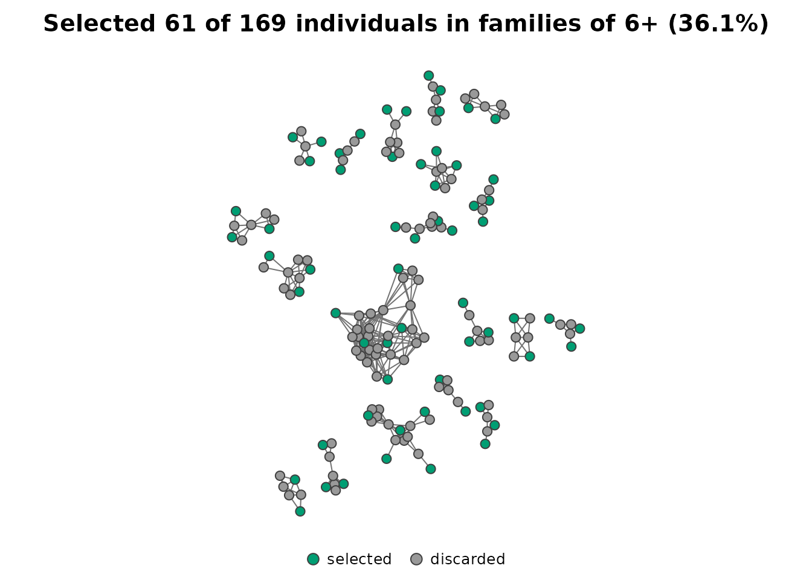

# Get started with RedKinNet

Many genetic analyses require a set of unrelated individuals. RedKinNet
selects one from pairwise kinship estimates: pairs related above a
threshold form a network, each connected component of the network is a
family, and a set of unrelated individuals of the largest possible size,
a *maximum set*, is chosen family by family. This vignette goes through
the whole workflow on the example cohort shipped with the package; the
vignettes *Selecting with covariates* and *Selection uncertainty* cover
the other ways of choosing.

``` r

library(RedKinNet)
```

## The example cohort

`rkn_example` is a synthetic cohort of 752 samples. Its kinship table
lists the pairs with an estimated kinship of at least 0.02, as written
by KING or by PLINK 2 with a minimum kinship; the samples without
relatives appear in no row, so their identifiers come from a separate
table, which also holds the covariates.

``` r

kin <- rkn_example$kinship
covariates <- rkn_example$samples
head(kin)
#>    id1  id2 kinship
#> 1 S001 S047  0.0369
#> 2 S001 S055  0.1139
#> 3 S001 S578  0.1364
#> 4 S001 S620  0.2500
#> 5 S001 S672  0.0654
#> 6 S002 S323  0.0557
head(covariates)
#>     id  sex age call_rate
#> 1 S001 <NA>  61    0.9984
#> 2 S002    M  21    0.9808
#> 3 S003    M  48    0.9986
#> 4 S004    F  86    0.9978
#> 5 S005    F  60    0.9986
#> 6 S006    F  58    0.9959
```

## Checking the samples

Before selecting,
[`rkn_check_samples()`](https://paolodalena.github.io/RedKinNet/reference/rkn_check_samples.md)
looks for samples that distort the network: pairs with a kinship above
0.354, possible duplicates or monozygotic twins, and samples related to
unusually many others, a sign of contamination of the DNA sample.

``` r

chk <- rkn_check_samples(kin, threshold = "third", samples = covariates$id)
chk
#> <rkn_sample_check> 752 samples, relatedness threshold 0.0442
#> 
#> Possible duplicates or monozygotic twins (kinship >= 0.354): 1 pair(s)
#>   id1  id2 kinship
#>  S685 S707   0.496
#> 
#> Possible contamination: 1 sample(s)
#> (related to unusually many samples)
#>    id n_relatives mean_kinship z_relatives z_kinship largest_family_without
#>  S672         631           NA         8.9        NA                     31
#> Largest family of the network: 717 samples;
#> without all the flagged samples together: 31 samples.
#> 
#> Ancestry not assessed: the mean kinship needs every pair of samples.
```

The contaminated sample is related to most of the cohort and holds
hundreds of samples in a single family; without it, the largest family
is much smaller. The duplicated pair needs no action for the selection,
which keeps at most one of the two samples, but it deserves a quality
check.

## Building the network

[`rkn_graph_from_kinship()`](https://paolodalena.github.io/RedKinNet/reference/rkn_graph_from_kinship.md)
joins the samples whose kinship reaches the threshold. The threshold is
a number or the name of a degree of relationship, `"duplicate"`,
`"first"`, `"second"` or `"third"`, for the corresponding KING cutoff;
`"third"` joins relatives up to first cousins. The contaminated sample
is excluded, and the covariates become vertex attributes. Since the
samples were checked above, `check = FALSE` skips the check that the
function would otherwise run.

``` r

g <- rkn_graph_from_kinship(kin, threshold = "third", samples = covariates$id,
                            exclude = chk$contamination$id, covariates = covariates,
                            check = FALSE)
g
#> IGRAPH 7fe094f UN-- 751 715 -- 
#> + attr: kinship_threshold (g/n), name (v/c), sex (v/c), age (v/n),
#> | call_rate (v/n), kinship (e/n)
#> + edges from 7fe094f (vertex names):
#>  [1] S001--S055 S001--S578 S001--S620 S002--S323 S002--S649 S004--S301
#>  [7] S005--S570 S008--S229 S008--S363 S009--S077 S009--S700 S010--S019
#> [13] S010--S101 S010--S300 S010--S310 S010--S320 S010--S553 S010--S659
#> [19] S012--S110 S012--S282 S013--S261 S014--S535 S014--S583 S014--S708
#> [25] S015--S379 S015--S644 S016--S074 S017--S030 S018--S034 S018--S049
#> [31] S018--S135 S018--S150 S018--S286 S018--S350 S018--S370 S018--S551
#> [37] S018--S683 S018--S713 S019--S300 S019--S553 S019--S659 S021--S234
#> + ... omitted several edges
table(igraph::components(g)$csize)
#> 
#>   1   2   3   4   5   6   7   8  10  16  31 
#> 233  67  26  18  13   7   4   4   2   1   1
```

Most samples have no relatives, and they are always selected; the
families with two or more members are those where a choice has to be
made.

## Selecting unrelated individuals

[`rkn_select_random()`](https://paolodalena.github.io/RedKinNet/reference/rkn_select_random.md)
returns a maximum set: each family is resolved by an exact algorithm
that draws one of all its maximum sets with equal probability. A seed
makes the selection reproducible.

``` r

sel <- rkn_select_random(g, seed = 1)
sel
#> <rkn_selection> Uniform random selection, seed 1
#> Call: rkn_select_random(g = g, seed = 1)
#> Individuals: 751 | selected: 452 (60.2%)
#> Families: 376 | size min/mean/max: 1 / 2.00 / 31
#> Families with up to 5 members: 357 | with 6 or more: 19
#> Families sampled uniformly among their maximum sets: 376 of 376
#> Maximum sets: 4.4e+54 in total; families with more than one: 127 of 376
#> Two uniform draws differ on average in 84.6 of the 452 selected individuals (18.7%)
head(sel$kept)
#> [1] "S047" "S620" "S339" "S382" "S649" "S003"
```

The printed summary reports how many maximum sets the network has and
how much two uniform draws differ on average: the selection is one of
many equally valid ones. The vignette *Selection uncertainty* shows how
to quantify the consequences.

With `uniform = FALSE`, structural rules keep or discard the members
whose fate is the same in the maximum sets they consider, and the
remaining choices are made at random. The result is still a maximum set,
but the rules never choose some of the maximum sets of larger families.

``` r

sel_rules <- rkn_select_random(g, uniform = FALSE, seed = 1)
sel_rules
#> <rkn_selection> Random selection, seed 1
#> Call: rkn_select_random(g = g, uniform = FALSE, seed = 1)
#> Individuals: 751 | selected: 452 (60.2%)
#> Families: 376 | size min/mean/max: 1 / 2.00 / 31
#> Families with up to 5 members: 357 | with 6 or more: 19
#> Families resolved by a search over maximum sets: 18
```

## Diagnostics

Each selection records how every individual was decided
(`node_diagnostics`) and how every family was resolved
(`family_summary`); the selection by rules also records the reason of
each decision.

``` r

head(sel_rules$node_diagnostics[, c("id", "pre_class", "post_class", "family_id", "family_size")])
#>     id         pre_class post_class family_id family_size
#> 1 S001 candidate_complex  discarded         1           5
#> 2 S047 candidate_complex  discarded         1           5
#> 3 S055 candidate_complex       kept         1           5
#> 4 S578 candidate_complex  discarded         1           5
#> 5 S620 candidate_complex       kept         1           5
#> 6 S002      kept_apriori       kept         2           6
summary(sel_rules)
#> <rkn_selection summary> Random selection, seed 1
#> Individuals: 751 | selected: 452 (60.2%) | families: 376
#> 
#> Selection by family structure:
#>  size                               structure families individuals selected
#>     1                       single individual      233         233      233
#>     2                            related pair       67         134       67
#>     3 chain of three (e.g. parents and child)        9          27       18
#>     3                  three mutually related       17          51       17
#>     4                     family of 4 members       18          72       29
#>     5                     family of 5 members       13          65       27
#>  6-31             family of 6 or more members       19         169       61
#> 
#> Individuals by type of decision and outcome:
#>                                  outcome
#> decision                          selected discarded
#>   kept without a choice                311         0
#>   discarded without a choice             0        93
#>   decided among single candidates      105       151
#>   decided among alternative sets        36        55
```

The plots draw the families with the selected and discarded individuals;
`min_family_size` leaves out the smallest families.

``` r

plot(sel, min_family_size = 6)
```



## Saving the selection

The selected identifiers can be written to a file for downstream tools,
for instance as a list of samples to keep in PLINK.

``` r

writeLines(sel$kept, "unrelated_samples.txt")
```
