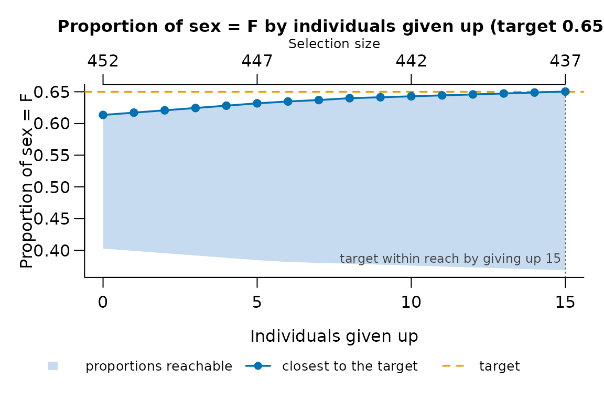

# Selecting with covariates

A family usually has several maximum sets, all equally large. Covariates
can decide among them in two ways: by preferring some individuals within
each family
([`rkn_select_criteria()`](https://paolodalena.github.io/RedKinNet/reference/rkn_select_criteria.md)),
or by steering the composition of the whole selection towards a target
proportion or mean
([`rkn_select_global()`](https://paolodalena.github.io/RedKinNet/reference/rkn_select_global.md)).
This vignette uses the example cohort, with the network built as in *Get
started with RedKinNet*.

``` r

library(RedKinNet)
kin <- rkn_example$kinship
covariates <- rkn_example$samples
chk <- rkn_check_samples(kin, threshold = "third", samples = covariates$id)
g <- rkn_graph_from_kinship(kin, threshold = "third", samples = covariates$id,
                            exclude = chk$contamination$id, covariates = covariates,
                            check = FALSE)
```

## Preferring individuals

A criterion states a preference:
[`rkn_criterion_cutoff()`](https://paolodalena.github.io/RedKinNet/reference/rkn_criterion_cutoff.md)
prefers values above or below a cutoff, and
[`rkn_criterion_level()`](https://paolodalena.github.io/RedKinNet/reference/rkn_criterion_level.md)
prefers one value of a covariate, such as cases over controls. Here the
samples with a call rate above 0.99, the better-genotyped ones, are
preferred whenever the family offers a choice.

``` r

prefer_quality <- rkn_criterion_cutoff("call_rate", cutoff = 0.99, prefer = "above")
sel <- rkn_select_criteria(g, prefer_quality, seed = 1)
sel
#> <rkn_selection> Criteria-based selection (cutoff), seed 1
#> Call: rkn_select_criteria(g = g, criterion_primary = prefer_quality, seed = 1)
#> Individuals: 751 | selected: 452 (60.2%)
#> Families: 376 | size min/mean/max: 1 / 2.00 / 31
#> Families with up to 5 members: 357 | with 6 or more: 19
#> Families resolved by a search over maximum sets: 18
```

By default the criteria decide the choices left open by the structural
rules. With `optimal = TRUE` they choose among all the maximum sets of
each family, so that the selection contains as many preferred
individuals as possible.

``` r

sel_optimal <- rkn_select_criteria(g, prefer_quality, optimal = TRUE, seed = 1)
low_quality <- function(s) sum(covariates$call_rate[match(s$kept, covariates$id)] <= 0.99)
c(default = low_quality(sel), optimal = low_quality(sel_optimal),
  uniform = low_quality(rkn_select_random(g, uniform = TRUE, seed = 1)))
#> default optimal uniform 
#>      74      72      98
```

A second criterion breaks the ties left by the first, for instance
preferring older individuals when the call rate does not decide.

``` r

prefer_older <- rkn_criterion_cutoff("age", cutoff = 50, prefer = "above")
rkn_select_criteria(g, prefer_quality, prefer_older, optimal = TRUE, seed = 1)
#> <rkn_selection> Criteria-based selection over all maximum sets (cutoff, then cutoff), seed 1
#> Call: rkn_select_criteria(g = g, criterion_primary = prefer_quality, criterion_secondary = prefer_older, optimal = TRUE, seed = 1)
#> Individuals: 751 | selected: 452 (60.2%)
#> Families: 376 | size min/mean/max: 1 / 2.00 / 31
#> Families with up to 5 members: 357 | with 6 or more: 19
#> Families where the criteria were evaluated over all maximum sets: 376 of 376
#> Maximum sets: 4.4e+54 in total; families with more than one: 127 of 376
```

Since every family keeps its largest size, a preference applied within
each family is also best for the selection as a whole: no choice in one
family can make up for another.

## A target composition

Some targets concern the selection as a whole: as many women as men, or
a mean age matching that of a group of cases. The best choice in one
family then depends on the others, and
[`rkn_select_global()`](https://paolodalena.github.io/RedKinNet/reference/rkn_select_global.md)
chooses all the families jointly, exactly.

``` r

balanced <- rkn_select_global(g, "sex", target = c(F = 0.5), seed = 1)
balanced
#> <rkn_selection> Global selection (proportion of sex = F), seed 1
#> Call: rkn_select_global(g = g, covariate = "sex", target = c(F = 0.5), seed = 1)
#> Individuals: 751 | selected: 452 (60.2%)
#> Families: 376 | size min/mean/max: 1 / 2.00 / 31
#> Families with up to 5 members: 357 | with 6 or more: 19
#> Proportion of sex = F among the selected: 0.5000 (222 of 444 with a known value; target 0.5)
#> Selected with a missing value of sex: 8
#> Selections reaching this proportion: 1.5e+53, one drawn uniformly
```

Without a target, the selection keeps the composition of the cohort.

``` r

rkn_select_global(g, "sex", seed = 1)
#> <rkn_selection> Global selection (proportion of sex = F), seed 1
#> Call: rkn_select_global(g = g, covariate = "sex", seed = 1)
#> Individuals: 751 | selected: 452 (60.2%)
#> Families: 376 | size min/mean/max: 1 / 2.00 / 31
#> Families with up to 5 members: 357 | with 6 or more: 19
#> Proportion of sex = F among the selected: 0.4910 (219 of 446 with a known value; target 0.4912, the proportion of the network)
#> Selected with a missing value of sex: 6
#> Selections reaching this proportion: 4.9e+51, one drawn uniformly
```

For a numeric covariate the target is a mean. The values are rounded to
a grid for the search, whose step is the `resolution`; the reported mean
is that of the recorded values. A family whose computation would exceed
the time and memory budget is resolved approximately, and the printed
summary says so; a coarser resolution makes the computation smaller.

``` r

rkn_select_global(g, "age", target = 50, seed = 1)
#> <rkn_selection> Global selection (mean of age), seed 1
#> Call: rkn_select_global(g = g, covariate = "age", target = 50, seed = 1)
#> Individuals: 751 | selected: 452 (60.2%)
#> Families: 376 | size min/mean/max: 1 / 2.00 / 31
#> Families with up to 5 members: 357 | with 6 or more: 19
#> Mean of age among the selected: 50.00 (437 individuals with a known value; target 50)
#> Selected with a missing value of age: 15
#> Families beyond the computational budget: 1; the mean may not be the best possible, and the choice within them is not uniform
rkn_select_global(g, "age", target = 50, resolution = 5, seed = 1)
#> <rkn_selection> Global selection (mean of age), seed 1
#> Call: rkn_select_global(g = g, covariate = "age", target = 50, resolution = 5, seed = 1)
#> Individuals: 751 | selected: 452 (60.2%)
#> Families: 376 | size min/mean/max: 1 / 2.00 / 31
#> Families with up to 5 members: 357 | with 6 or more: 19
#> Mean of age among the selected: 50.02 (440 individuals with a known value; target 50)
#> Values of age rounded to multiples of 5 for the search: the distance of this mean from the target exceeds the smallest possible by at most 5
#> Selected with a missing value of age: 12
#> Selections reaching this mean of the rounded values: 3.4e+51, one drawn uniformly
```

## Giving up individuals for a closer composition

The selections of the largest size reach a range of compositions, and a
target outside that range cannot be met without giving up individuals.
[`rkn_tradeoff()`](https://paolodalena.github.io/RedKinNet/reference/rkn_tradeoff.md)
shows, before selecting, the composition reachable for each number of
individuals given up.

``` r

tr <- rkn_tradeoff(g, "sex", target = c(F = 0.65))
tr
#> <rkn_tradeoff> Proportion of sex = F by individuals given up (target 0.65)
#> Largest selection: 452 individuals, proportion of F from 0.4027 to 0.6135
#> Target within reach by giving up 15 (3.3% of the largest selection), a selection of 437
#> Proportions among the selected individuals with a known value of sex
#>  loss size proportion distance min_proportion max_proportion selections
#>     0  452     0.6135   0.0365         0.4027         0.6135    6.1e+23
#>     1  451     0.6171   0.0329         0.3991         0.6171    3.2e+24
#>     2  450     0.6208   0.0292         0.3955         0.6208    6.1e+24
#>     3  449     0.6244   0.0256         0.3918         0.6244    5.6e+24
#>     4  448     0.6281   0.0219         0.3881         0.6281    2.5e+24
#>     5  447     0.6318   0.0182         0.3844         0.6318    4.1e+23
#>     6  446     0.6347   0.0153         0.3816         0.6347    2.0e+23
#>     7  445     0.6370   0.0130         0.3802         0.6370    8.2e+23
#>     8  444     0.6399   0.0101         0.3788         0.6399    4.1e+23
#>     9  443     0.6414   0.0086         0.3773         0.6414    6.3e+25
#>    10  442     0.6429   0.0071         0.3759         0.6429    4.9e+27
#>    11  441     0.6443   0.0057         0.3744         0.6443    2.5e+29
#>    12  440     0.6458   0.0042         0.3730         0.6458    9.3e+30
#>    13  439     0.6473   0.0027         0.3715         0.6473    2.8e+32
#>    14  438     0.6488   0.0012         0.3700         0.6488    7.0e+33
#>    15  437     0.6503   0.0003         0.3685         0.6503    1.5e+35
```

``` r

plot(tr)
```



The argument `max_loss` of
[`rkn_select_global()`](https://paolodalena.github.io/RedKinNet/reference/rkn_select_global.md)
then allows that many individuals to be given up.

``` r

rkn_select_global(g, "sex", target = c(F = 0.65), max_loss = attr(tr, "tradeoff")$reached, seed = 1)
#> <rkn_selection> Global selection (proportion of sex = F), seed 1
#> Call: rkn_select_global(g = g, covariate = "sex", target = c(F = 0.65), max_loss = attr(tr, "tradeoff")$reached, seed = 1)
#> Individuals: 751 | selected: 437 (58.2%)
#> Families: 376 | size min/mean/max: 1 / 2.00 / 31
#> Families with up to 5 members: 357 | with 6 or more: 19
#> Proportion of sex = F among the selected: 0.6503 (279 of 429 with a known value; target 0.65)
#> Selected with a missing value of sex: 8
#> Selected: 437 of a largest possible 452 (max_loss = 15)
#> Selections reaching this proportion and size: 1.5e+35, one drawn uniformly
```
